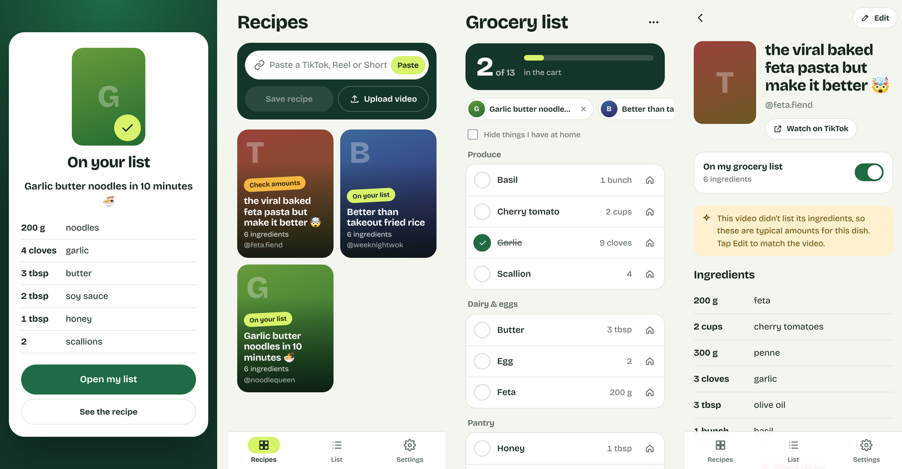

# Reel Groceries

**Share a TikTok, Reel or Short. Its ingredients land on your grocery list.**

People save recipe videos and never cook them, because turning a 45-second video into a shopping list is tedious. Reel Groceries installs on your phone like an app and shows up in the Share menu. Tap **Share → Reel Groceries** on any recipe video, and a few seconds later the ingredients are on your grocery list: merged with everything else you've saved and sorted by store aisle.



[Watch the 1-minute demo](docs/demo.mp4)

## What it does

- **Share straight from TikTok, Instagram or YouTube.** The app registers as a share target, so it appears in your phone's share sheet. Pasting a link or uploading a saved video also works.
- **Extracts the recipe automatically**, from the caption and, when available, from what the creator says.
- **Fills in the gaps.** If a video names a dish but never lists the ingredients, the AI suggests typical amounts and flags the recipe "Check amounts" so you know to look.
- **Keeps one living grocery list.** New recipes are added automatically (you can turn this off). Duplicates merge with unit conversion: 1 cup + 4 tbsp of flour becomes 1 1/4 cups.
- **Works in the store.** Items are grouped by aisle. Tap to tick things off, and mark what's already at home. Ticks survive when new recipes are added.
- **Stays in sync.** Edit a recipe and the list updates. Remove a recipe and its ingredients come off the list, while anything you typed in yourself stays.

## How sharing works

```
TikTok / Instagram / YouTube
        │  Share → Reel Groceries
        ▼
Service worker (/share-target)        the installed app's share target
        │  stashes the link or video, opens /share
        ▼
/share screen ── POST /api/videos/link (or /api/videos for a file)
        │                                  │
        │                                  ▼
        │                    background job (Redis + RQ)
        │                     1. oEmbed: caption, creator, thumbnail
        │                     2. optional: download + transcribe speech
        │                     3. AI (or rules): text → structured recipe
        │                     4. estimate ingredients if none were listed
        │                     5. add to your list, merging duplicates
        ▼                                  │
"On your list ✓" ◄──────── polls ─────────┘
```

**Links, not scraping.** By default the app reads public post metadata through each platform's official **oEmbed** endpoint, which exists for apps that link to and embed posts. That returns the caption, creator and thumbnail:

| Platform | What works out of the box |
| --- | --- |
| TikTok | Caption, creator and thumbnail via the official oEmbed endpoint |
| YouTube Shorts | Title, creator and thumbnail via the official oEmbed endpoint |
| Instagram Reels | Needs a Meta app token (`INSTAGRAM_OEMBED_TOKEN`). Without it the Reel is saved and you paste its caption. |

Downloading the video itself, so the app can transcribe what the creator *says*, is **opt-in** (`ENABLE_VIDEO_DOWNLOAD=true`, uses yt-dlp). Check each platform's terms before turning it on. Sharing a saved video file always works and is transcribed with Whisper.

### Phones

| | Android (Chrome) | iPhone (Safari) |
| --- | --- | --- |
| Install to home screen | Yes, with an Install button in the app | Yes, via Share → Add to Home Screen |
| Appears in the Share menu | Yes | No. Apple doesn't let web apps join the share sheet. Copy the link and tap **Paste** in the app, or make an iOS Shortcut that opens `https://your-domain/share?url=<link>` |

A native iOS share extension (via Capacitor or React Native) is the natural next step for one-tap sharing on iPhone.

The share target only works over **HTTPS** on a real domain (or `localhost` for testing), so deploy the app before trying it on your phone.

## Tech stack

| Layer | Choice |
| --- | --- |
| App | React 18, TypeScript, Vite, installable PWA (manifest, service worker, Web Share Target) |
| API | FastAPI, Pydantic v2 |
| Database | PostgreSQL (SQLite for local dev and tests), SQLAlchemy 2.0 |
| Jobs | Redis + RQ (falls back to in-process tasks without Redis) |
| Video | oEmbed for links, ffmpeg + faster-whisper for speech, optional yt-dlp |
| AI | Claude via the Messages API, with a rule-based fallback |
| Auth | PBKDF2 password hashing, JWT bearer tokens |
| Tests | pytest (116 tests), Vitest |
| Ops | Docker Compose, nginx, GitHub Actions |

## Running it

### Everything with Docker

```bash
cp .env.example .env          # add ANTHROPIC_API_KEY for AI extraction
docker compose up --build
```

Open http://localhost:8080. This starts Postgres, Redis, the API, a worker and the web app.

### Local development

Needs Python 3.12+, Node 20+ and ffmpeg.

```bash
cd backend
pip install -r requirements-dev.txt
pip install -r requirements-whisper.txt     # optional: speech-to-text
uvicorn app.main:app --reload               # API on :8000

cd frontend
npm install
npm run dev                                 # app on :5173, proxies /api
```

Open http://localhost:5173 on your computer, or use Chrome's device toolbar to see the phone layout. API docs are at http://localhost:8000/docs.

> Upgrading from the first version? The schema changed. Delete `backend/reel_groceries.db` (or the Postgres volume) and restart.

### Tests

```bash
cd backend && pytest          # units, extraction, sharing, list sync, full API flows
cd frontend && npm test
```

## Project structure

```
backend/app/
  routers/          auth, videos (upload + share link), recipes, lists
  services/
    social.py       link parsing, platform detection, oEmbed, optional download
    extraction.py   AI + rule-based recipe extraction, ingredient estimates
    lists.py        the default list, rebuilds that keep ticks, add/remove recipes
    units.py        quantity parsing, unit conversion, merging, aisles
    pipeline.py     the background job
frontend/
  public/
    manifest.webmanifest   app name, icons, share target
    sw.js                  receives shares, offline shell
  src/
    pages/          Home, Share, Recipe, List, Settings, Welcome
    pwa.ts          install prompt, share inbox, clipboard
```

## Design decisions

**The service worker receives shares, not the API.** A share-sheet POST carries no auth token, so the service worker stores what was shared in the Cache API and opens `/share`, where the signed-in app sends it on. If you're signed out, the share waits until you log in.

**The grocery list is derived, not edited.** It's rebuilt from its recipes whenever they change, and the rebuild carries over ticks and "at home" marks by ingredient name. Items you type yourself are flagged `custom` and kept as-is.

**Estimated ingredients are labelled.** When the AI guesses typical amounts, the recipe is marked `estimated` and the UI says so. The extraction prompt itself forbids guessing amounts; only the separate estimate step may.

**Quantities are Decimals, never floats**, and merging only happens within a unit family. Cups and tablespoons merge; cups and grams don't, because that needs the ingredient's density.

**Sharing the same post twice is a no-op**, and other users' resources return 404 rather than 403 so IDs can't be probed.

## What's next

- Native iOS share extension (Capacitor) for one-tap sharing on iPhone
- Alembic migrations
- Scale a recipe by servings before it goes on the list
- Share a list with a partner, with live updates
