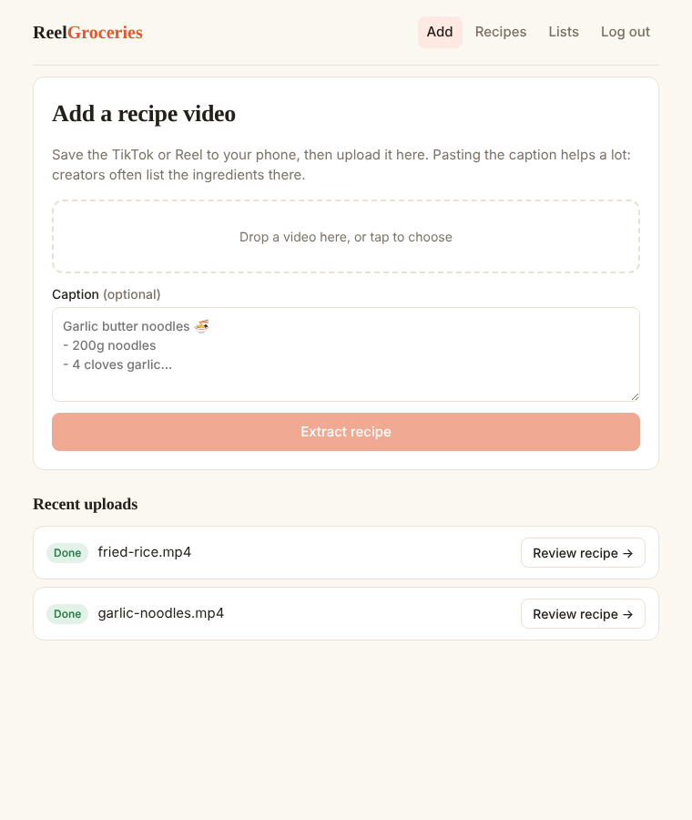
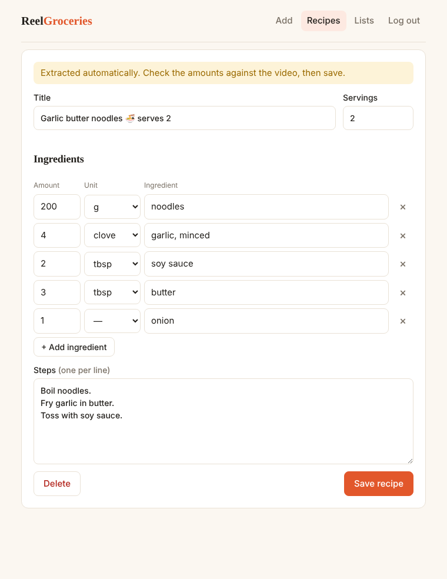
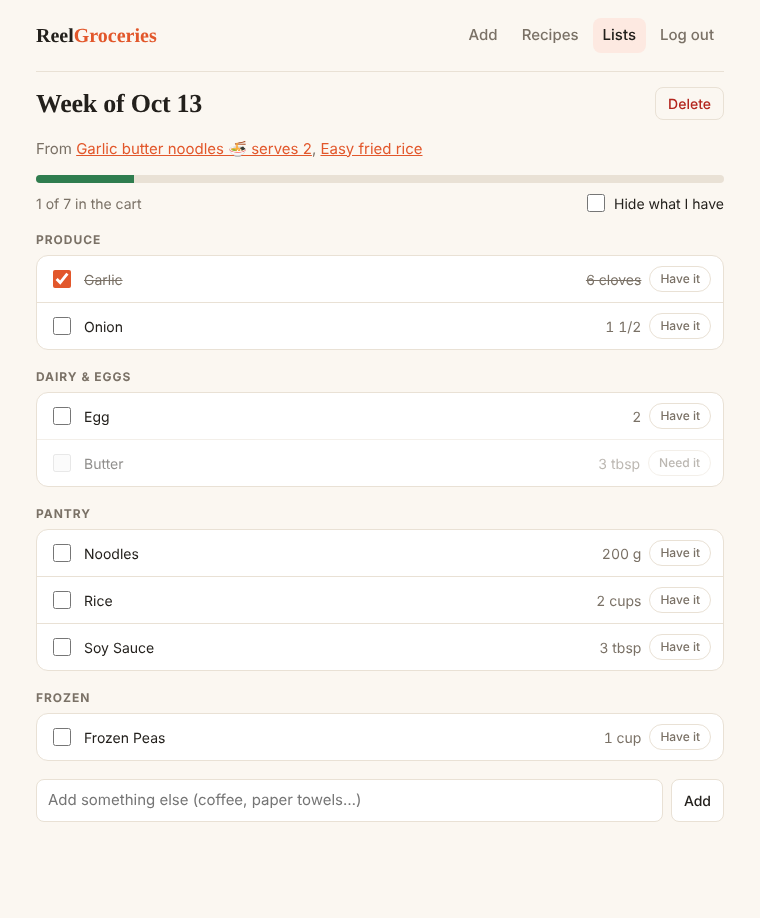

# Reel Groceries

**Turn saved TikTok and Instagram recipe videos into one merged grocery list.**

People save recipe videos and never cook them, because getting from a 45-second video to a shopping list is tedious. Upload the video, and Reel Groceries transcribes it, extracts the ingredients, lets you fix anything it got wrong, and merges several recipes into one list sorted by store aisle.

| Upload | Review | Shop |
| --- | --- | --- |
|  |  |  |

## Features

- Upload a recipe video (mp4, mov, webm) with an optional caption
- Background processing: audio extraction → speech-to-text → recipe extraction
- Review screen to correct amounts and units before saving ("1 1/2", "½" and "1.5" all work)
- Grocery lists that merge duplicates across recipes, including unit conversion (1 cup + 4 tbsp flour = 1 1/4 cups)
- Items grouped by aisle in store-walking order, with check-off and "already have it"
- Accounts with per-user data isolation

## How it works

```
 Browser (React)
     │  POST /api/videos (multipart)
     ▼
 FastAPI ──► save file ──► enqueue job ──► 202 Accepted
     ▲                          │
     │ poll status              ▼
     │                    RQ worker (Redis)
     │                          │ 1. ffmpeg: video → 16 kHz mono audio
     │                          │ 2. faster-whisper: audio → transcript
     │                          │ 3. Claude (or rule-based parser): caption + transcript → JSON recipe
     │                          │ 4. validate, parse quantities, normalize units
     └──────── PostgreSQL ◄─────┘
```

Every stage degrades gracefully:

| If… | Then… |
| --- | --- |
| The video has no audio track | Skip transcription and use the caption |
| faster-whisper isn't installed | Same: caption only |
| No `ANTHROPIC_API_KEY` is set | Use the regex-based extractor |
| The LLM returns invalid JSON or errors | Log it and fall back to the regex extractor |
| There's no speech and no caption | Mark the video failed with a clear message; the user can paste a caption and retry |
| Nothing looked like an ingredient | Create the recipe anyway with a warning, so the user can type them in |

## Tech stack

| Layer | Choice |
| --- | --- |
| API | FastAPI, Pydantic v2 |
| Database | PostgreSQL (SQLite for local dev and tests), SQLAlchemy 2.0 |
| Jobs | Redis + RQ (falls back to in-process background tasks without Redis) |
| Media | ffmpeg, faster-whisper (optional) |
| Extraction | Claude via the Messages API, with a deterministic rule-based fallback |
| Auth | PBKDF2 password hashing (stdlib), JWT bearer tokens |
| Frontend | React 18, TypeScript, Vite, React Router |
| Tests | pytest (85 tests), Vitest |
| Ops | Docker Compose, nginx, GitHub Actions |

## Running it

### Everything with Docker

```bash
cp .env.example .env          # optional: add ANTHROPIC_API_KEY
docker compose up --build
```

Open http://localhost:8080. This starts Postgres, Redis, the API, a worker and the web app.

### Local development (no Docker)

Needs Python 3.12+, Node 20+ and ffmpeg.

```bash
# API on :8000 (SQLite, in-process jobs)
cd backend
pip install -r requirements-dev.txt
pip install -r requirements-whisper.txt   # optional, for speech-to-text
uvicorn app.main:app --reload

# Web app on :5173 (proxies /api to :8000)
cd frontend
npm install
npm run dev
```

Interactive API docs: http://localhost:8000/docs

### Tests

```bash
cd backend && pytest        # units, extraction, full API flows with real ffmpeg
cd frontend && npm test
```

## Project structure

```
backend/
  app/
    main.py              app setup, CORS, routers
    models.py            SQLAlchemy models (users, videos, recipes, ingredients, lists, items)
    schemas.py           request/response validation
    auth.py              password hashing, JWT, current_user dependency
    storage.py           file storage behind a small interface (swap for S3 here)
    jobs.py              enqueue on RQ, or run in-process
    routers/             auth, videos, recipes, lists
    services/
      units.py           quantity parsing, unit normalization, merging   ← the core logic
      extraction.py      LLM and rule-based recipe extraction
      media.py           ffmpeg + whisper
      pipeline.py        the background job
  tests/
  worker.py              RQ worker entry point
frontend/
  src/
    api.ts               typed API client
    grocery.ts           aisle grouping and formatting (unit tested)
    pages/               upload, recipes, review/edit, lists
```

## Design decisions and tradeoffs

**Quantities are Decimals, never floats.** With floats, 1/3 cup + 2/3 cup is 0.9999 cups. The API accepts "1 1/2", "½", "1.5" or "2-3" (buys for the upper end), and stores the parsed value next to the original text.

**Merging only within a unit family.** Cups and tablespoons merge because both are volume. Cups and grams of flour don't, because converting needs the ingredient's density. Two honest lines beat one wrong number.

**Ingredient names are normalized only to build the merge key.** "2 large onions, finely diced" and "1/2 onion" both key to `onion`, but the raw text is kept for the review screen.

**The LLM's output is untrusted.** It's parsed out of any surrounding prose, validated with Pydantic, and rejected on failure, which triggers the rule-based fallback. The prompt tells the model not to guess amounts, and a human reviews every recipe before it's marked reviewed.

**Uploads, not links.** Downloading from TikTok or Instagram by URL is fragile and generally against their terms. Users save the video and upload the file.

**Jobs are idempotent-ish.** A worker skips videos that are already processing, every job ends in a terminal state (`done` or `failed`), and retrying replaces the old draft recipe instead of duplicating it.

**Other users' resources return 404, not 403**, so IDs can't be probed. Login returns the same error for unknown emails and wrong passwords for the same reason.

**Schema via `create_all`.** Simple for now; the next step is Alembic migrations.

## What I'd do next

- Alembic migrations
- OCR on sampled frames for on-screen ingredient text
- Scale a recipe by servings before adding it to a list
- A pantry that remembers what you always have
- S3 storage and deleting video files once processed
- Share a grocery list with a partner, with live updates
